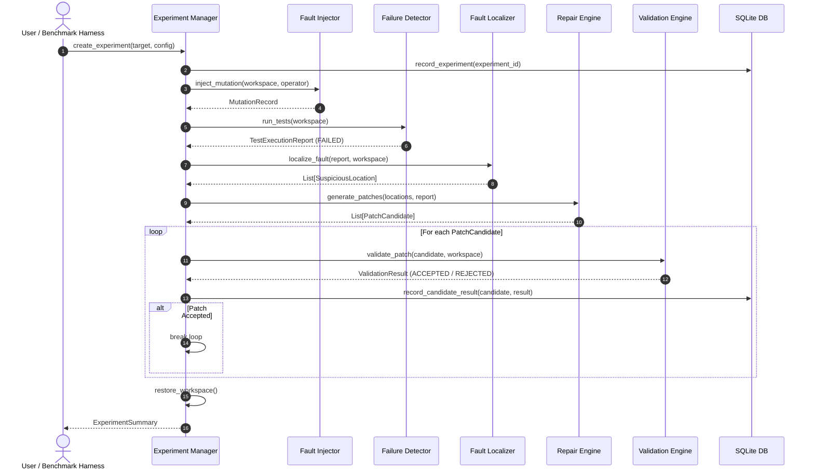

# System Architecture — THE MACHINE

## 1. System Vision & Overview

**The Machine** is an autonomous, research-grade software reliability and automated program repair (APR) engine designed around a dual-loop architecture:

- **Loop 1 (Software Repair Loop):** Detects failures, localizes candidate faults, synthesizes repairs, validates candidate patches against rigorous test and invariant suites, and records outcomes.
  $$\text{Understand} \longrightarrow \text{Diagnose} \longrightarrow \text{Repair} \longrightarrow \text{Verify} \longrightarrow \text{Learn}$$
- **Loop 2 (Meta-Learning & System Evolution Loop):** Analyzes historical repair performance across failure classes, refines strategy selection policies, and proposes improvements to internal heuristics under strict human oversight and offline bench validation.

```
+-----------------------------------------------------------------------------------+
|                                     THE MACHINE                                   |
|                                                                                   |
|  +-------------------------+     +-----------------------+     +---------------+  |
|  |   Experiment Manager    |---->| Failure Detector      |---->| Fault         |  |
|  | - UUID / Run tracking   |     | - Subprocess runner   |     |   Localizer   |  |
|  | - Isolated worktree     |     | - Pytest/Trace parser |     | - Ochiai SBFL |  |
|  | - Snapshot & rollback   |     | - Resource sandbox    |     | - AST & Trace |  |
|  +-------------------------+     +-----------------------+     +---------------+  |
|               |                              |                         |          |
|               v                              v                         v          |
|  +-------------------------+     +-----------------------+     +---------------+  |
|  | SQLite Experiment Store |<----+ Validation Engine     |<----+ Repair        |  |
|  | - Schema v1             |     | - Regression check    |     |   Engine      |  |
|  | - Telemetry & audit     |     | - AST sanity check    |     | - Templates   |  |
|  | - Strategy benchmarks   |     | - Overfit rejection   |     | - Search AST  |  |
|  +-------------------------+     +-----------------------+     +---------------+  |
|               ^                                                                   |
|               |                                                                   |
|  +-------------------------+                                                      |
|  | Learning & Strategy     |                                                      |
|  |   Selection (Bandits)   |                                                      |
|  +-------------------------+                                                      |
+-----------------------------------------------------------------------------------+
```

---

## 2. Core Modules and Interfaces

### 2.1 Experiment Manager (`the_machine.engine.experiment_manager`)
- **Responsibilities:**
  - Manages experiment lifecycles: generates monotonic/UUIDv4 identifiers, provisions disposable workspace copies, captures source state snapshots before any alteration, and ensures deterministic rollback.
  - Guarantees non-destructive isolation: The original target project files are never mutated directly during candidate evaluation.
- **Contract:**
  - `create_experiment(target_path, config) -> Experiment`
  - `prepare_isolated_workspace(experiment_id) -> Path`
  - `restore_workspace(experiment_id) -> None`
  - `cleanup_workspace(experiment_id) -> None`

### 2.2 Fault Injection Engine (`the_machine.engine.fault_injector`)
- **Responsibilities:**
  - Injects controlled, deterministic, traceable AST mutations to simulate realistic defects.
  - Supported mutation operators:
    1. **Comparison Operator Mutation (COM):** Inverts comparison operators (`<` to `<=`, `==` to `!=`, `>` to `<`).
    2. **Boolean Logic Inversion (BLI):** Inverts boolean logic (`not`, `and` to `or`).
    3. **Boundary Condition Off-by-One (OB1):** Shifts arithmetic boundaries (`+ 1`, `- 1`).
    4. **Constant & Return Substitution (CRS):** Alters literal constants or return primitives (`0` to `1`, `True` to `False`, returns `None`).
    5. **Null / Guard Removal (NGR):** Removes or corrupts defensive guard clauses.
- **Contract:**
  - `inject_mutation(file_path, operator_name, location_hint) -> MutationRecord`
  - `revert_mutation(record) -> None`

### 2.3 Failure Detection (`the_machine.engine.failure_detector`)
- **Responsibilities:**
  - Executes test suites in a secured subprocess with strict wall-clock and CPU timeouts.
  - Distinguishes syntax errors, test assertion failures, runtime exceptions, timeouts, and environmental faults.
  - Collects structured telemetry: stdout, stderr, exception types, failed test IDs, and stack traces.
- **Contract:**
  - `run_tests(workspace_path, test_selector=None, timeout_sec=10.0) -> TestExecutionReport`

### 2.4 Fault Localization (`the_machine.engine.fault_localizer`)
- **Responsibilities:**
  - Correlates failing execution traces and coverage metrics to compute suspiciousness scores for program elements (files, classes, functions, line numbers).
  - Implements Spectrum-Based Fault Localization (SBFL) with the **Ochiai metric**:
    $$\text{Suspiciousness}(s) = \frac{failed(s)}{\sqrt{\text{total\_failed} \times (failed(s) + passed(s))}}$$
  - Implements Stack Trace Slicing (STS): Extracts frames directly participating in unhandled exceptions within user code.
- **Contract:**
  - `localize_fault(report, workspace_path) -> List[SuspiciousLocation]`

### 2.5 Repair Engine (`the_machine.engine.repair_engine`)
- **Responsibilities:**
  - Extensible strategy architecture implementing candidate patch synthesis.
  - Supported strategies:
    1. `DeterministicTemplateStrategy`: Fast, rule-based transformation patterns for localized fault categories (e.g., inverting comparison operator, adjusting off-by-one boundary, re-inserting missing null checks).
    2. `SearchBasedASTStrategy`: Systematic bounded search over AST node replacements within suspicious statements.
    3. `LLMAdapterStrategy` *(Optional / Pluggable)*: External generation interface strictly decoupled from the core monolith.
- **Contract:**
  - `RepairStrategy.generate_patches(location, evidence, context) -> List[PatchCandidate]`

### 2.6 Validation Engine (`the_machine.engine.validation_engine`)
- **Responsibilities:**
  - Tests proposed patches within disposable target workspaces.
  - Enforces rigorous non-overfitting invariants:
    - Target failing test must transition from `FAIL` to `PASS`.
    - Entire regression test suite must execute and pass without regressions (`0` failures).
    - Syntax and AST check: must compile cleanly.
    - Anti-trivial check: Rejects patches that delete tests, weaken assertions, add unconditional `return`, or silence exceptions with bare `except: pass`.
- **Contract:**
  - `validate_patch(candidate, workspace_path) -> ValidationResult`

### 2.7 Experiment Database & Storage (`the_machine.core.database`)
- **Responsibilities:**
  - SQLite relational repository tracking experiments, injected mutations, diagnostic observations, synthesized patches, and validation metrics.
  - Append-only schema preserving complete lineage for every repair attempt.

### 2.8 Learning & Strategy Selector (`the_machine.engine.strategy_selector`)
- **Responsibilities:**
  - Tracks success rates and computational costs per repair strategy conditioned on fault categories.
  - Multi-armed bandit / contextual dispatch: Chooses optimal repair strategies based on empirical success likelihood.

---

## 3. Data Flow



---

## 4. Trust Boundaries & Security Model

1. **Subprocess Isolation:** Target software under repair and generated patch candidates are executed in dedicated, sandboxed subprocesses with:
   - Configurable wall-clock timeouts (default 10s).
   - Restricted working directory (operations confined to disposable temporary copies).
   - Environment sanitization (removal of API keys, token secrets, and system administrative variables).
2. **Immutable Original Code:** The canonical repository path is never altered in-place. All mutations, patch applications, and validations occur within ephemeral workspace directories (`.machine_workspaces/<exp_id>`).
3. **Restoration Guarantees:** Experiment completion (whether successful, crashed, or terminated) triggers automatic rollback and workspace purge.
